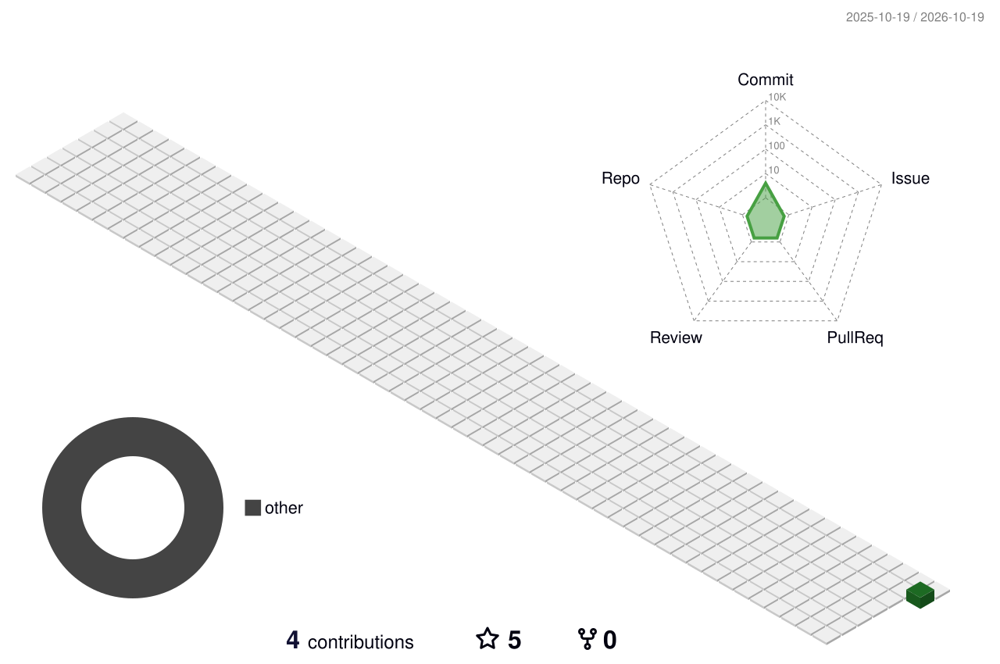
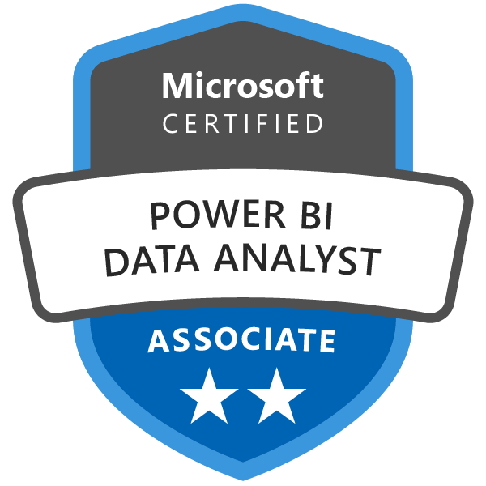
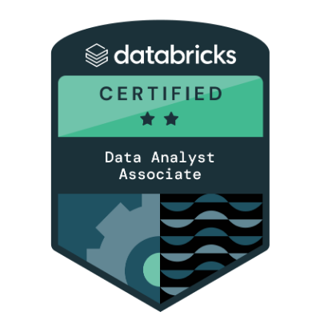
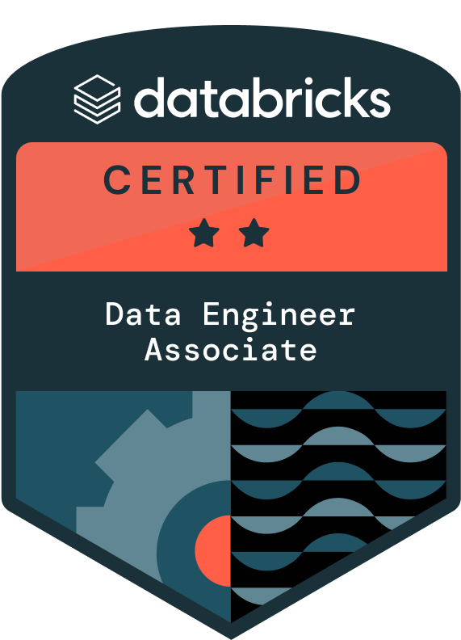
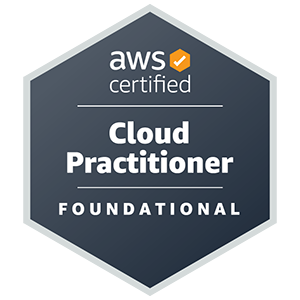
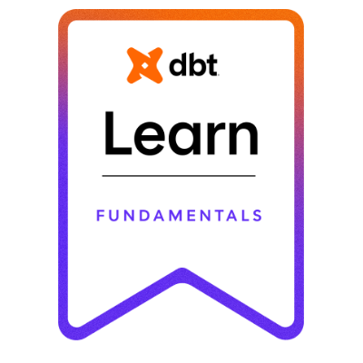

## 👋 Hi, I'm Bassam!

I'm an **Analytics Engineer** passionate about transforming raw data into actionable insights and building scalable, reliable analytics solutions.

Certified in **Microsoft Power BI, Databricks, and AWS**, with a strong interest in **Data Engineering, Cloud Computing, Business Intelligence, and Analytics Architecture**.

🏋️ **Beyond Data:** Calisthenics, Street Lifting & Muay Thai.

📚 **Philosophy:** Passionate about Stoicism, discipline, and continuous self-improvement.

✍️ **Writing:** Sharing insights on Data, Technology, Sports, and Philosophy through [**Data Mediator**](https://medium.com/@bassam.data.mediator).

💻 Always exploring new technologies and modern approaches to data analytics and cloud engineering.

---

### 🌱 Currently Exploring

- 🟦 **Google BigQuery** — Advanced SQL, query optimization, performance tuning & FinOps.
- 🔍 **Modern Data Stack** — Google Cloud, Microsoft Fabric, Snowflake & multi-cloud data architectures.

---

### 📫 Connect With Me

---

### 📊 GitHub Stats

  
  

### 🌐 3D Contribution Graph
<!-- 

  

-->
---

### 🎖️ Certifications & Badges

  <table>
    <tr>
      <td align="center" width="140">
        
         
        <b>Microsoft</b> Power BI Data Analyst
      </td>
      <td align="center" width="140">
        
         
        <b>Databricks</b> Data Analyst
      </td>
      <td align="center" width="140">
        
         
        <b>Databricks</b> Data Engineer
      </td>
      <td align="center" width="140">
        
         
        <b>AWS</b> Cloud Practitioner
      </td>
      <td align="center" width="140">
        
         
        <b>dbt</b> Fundamentals
      </td>
    </tr>
  </table>

